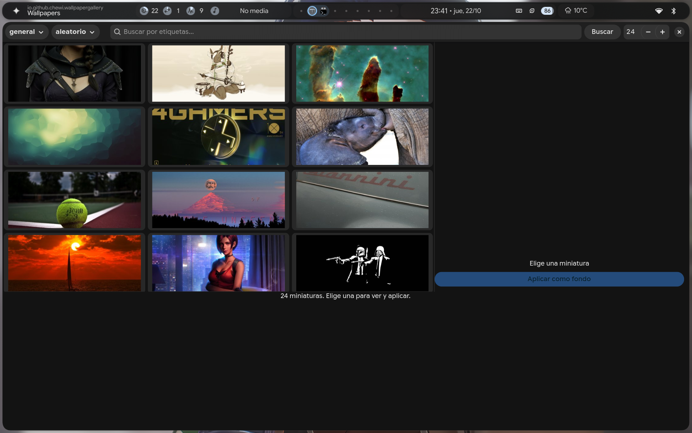

# hypr-wallpaper-picker

Wallpapers online para **Hyprland + Noctalia (illogical-impulse)** con **previews**
y **tema Material You automático**: eliges la imagen y el tema entero se
regenera a partir de ella.

> Previsualizas miniaturas ligeras y **solo se descarga la imagen que eliges**.



## Qué hace

| Pieza | Función |
|---|---|
| `wallpaper_gallery.py` | Galería GTK4: rejilla de previews, buscador, categorías, **doble clic aplica** |
| `wallpaper_fetch.sh` | Descargador (wallhaven + Bing), lotes en paralelo, recorte a la resolución de pantalla |
| `wallpaper_pick.sh` | Selector con miniaturas (KDE) como alternativa ligera a la galería |
| `wallpaper_menu.sh` | Menú `fuzzel` que une todas las fuentes |
| `wallpaper_apply.sh` | Aplica el fondo y **regenera el tema** vía `switchwall.sh` → `matugen` |

### Fuentes

- **wallhaven.cc** — API pública v1, sin clave para contenido SFW.
  Categorías *general* / *anime* / *personas*, búsqueda por etiquetas, `toplist`,
  orden por aleatorio / relevancia / más vistos / nuevos.
- **Bing** — imagen del día, sin clave.

## Requisitos

- Hyprland con el shell **Noctalia / illogical-impulse** (para `switchwall.sh` y `matugen`)
- `curl`, `jq`, `magick` (ImageMagick), `fuzzel`
- `python-gobject` + **GTK 4** (para la galería)
- `kdialog` (KDE) si quieres el selector alternativo

```bash
sudo pacman -S curl jq imagemagick fuzzel python-gobject gtk4 kdialog
```

## Instalación

```bash
git clone https://github.com/darwingtx/hypr-wallpaper-picker.git
cd hypr-wallpaper-picker
./install.sh
```

El instalador copia los scripts a `~/.config/hypr/custom/scripts/`, añade los
atajos a `~/.config/hypr/custom/keybinds.lua` y crea las acciones del launcher
en `~/.config/illogical-impulse/actions/`.

## Uso

| Atajo | Acción |
|---|---|
| `SUPER + SHIFT + G` | Galería con previews (recomendado) |
| `SUPER + SHIFT + W` | Menú con todas las fuentes |

En el launcher del shell también aparecen las acciones **`wallpaper-gallery`** y
**`wallpaper`**.

### La galería

- Arriba: categoría (*general / anime / personas / todo*), orden
  (*aleatorio / toplist / relevancia / más vistos / nuevos*), buscador de
  etiquetas y cantidad de miniaturas.
- Clic en una miniatura → preview grande a la derecha.
- Doble clic o **«Aplicar como fondo»** → descarga el original, lo recorta a tu
  resolución y aplica fondo + tema.

Las miniaturas se cachean en `~/.cache/wallpaper-gallery/`, así que la segunda
búsqueda es instantánea.

### El menú

`SUPER + SHIFT + W` da acceso a: galería, wallhaven por categoría, toplist,
búsqueda por etiquetas, Bing y el visor de la carpeta.

## Cómo se aplica el tema

El shell (Noctalia) dibuja el fondo **por encima de cualquier backend**
(`hyprpaper`, `awww`, `swaybg`…), por lo que esos backends quedan invisibles.
La única forma correcta de aplicar el fondo es el script del propio shell:

```
wallpaper_apply.sh
        └── switchwall.sh --imagen --mode
                ├── fija el fondo del shell
                ├── matugen → paleta Material You
                ├── scheme_for_image.py → neutral o tonal-spot según la imagen
                └── aplica los colores a terminal, apps Qt y shell
```

Por eso **no hace falta levantar ningún backend externo** y el arranque no se
ralentiza.

## Problemas frecuentes

**Quedan procesos `switchwall.sh` colgados.**
El aviso *"Upscale?"* de los dots usa `notify-send -A`, que **espera a que
atiendas la notificación**. Si la ignoras, el proceso se queda ahí. Descarta la
notificación oCiérrala. Las imágenes de este proyecto se recortan ya a la
resolución de la pantalla, así que el aviso no aparece.

**La galería no encuentra imágenes.**
Comprueba la red y que `atleast=1920x1200` no filtre demasiado. Cambia la
resolución mínima con `WALLPAPER_MIN_RES=1920x1080`.

**`waypaper` no se ve al aplicar.**
Correcto: el shell tapa su capa. En este repositorio waypaper se usa solo como
visor de la carpeta, con `backend = none` y un `post_command` que delega en
`wallpaper_apply.sh`.

**El wallpaper desaparece de la carpeta.**
El lote anterior se borra al pedir candidatos nuevos, pero nunca se borra el
archivo que el shell tiene puesto en ese momento.

## Variables de entorno

| Variable | Por defecto | Uso |
|---|---|---|
| `WALLPAPER_DEST_DIR` | `~/Pictures/Wallpapers` | Dónde se guardan |
| `WALLPAPER_MIN_RES` | `1920x1200` | Resolución a la que se ajustan |
| `XDG_STATE_HOME` | `~/.local/state` | Estado (lote actual, último usado) |

## Desarrollo

```bash
# probar sin instalar
scripts/wallpaper_fetch.sh candidates general "" 8
scripts/wallpaper_gallery.py
```

## Licencia

MIT.
